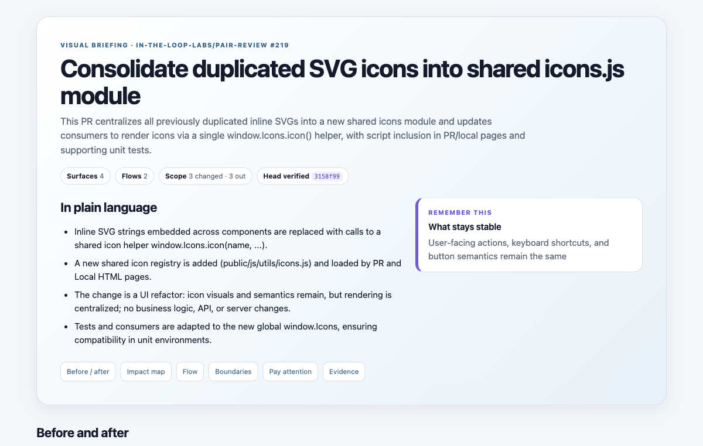
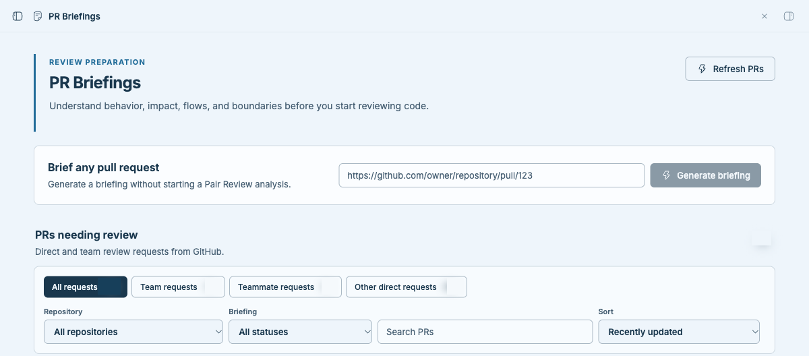
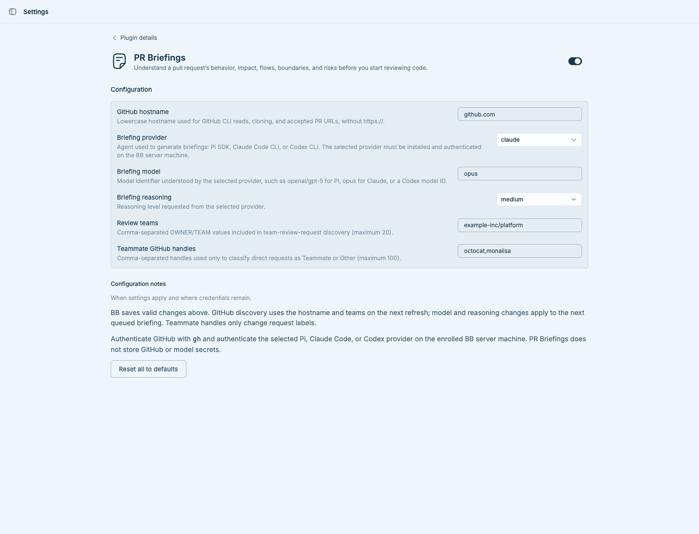

# PR Briefings for BB

PR Briefings turns a GitHub pull request into an evidence-backed visual explanation of its behavior change, affected surfaces, information flows, boundaries, and high-level risks. It is designed for review preparation: generation is explicit, viewing a PR never starts analysis, and the plugin does not comment on or modify the pull request.

## What you can do

- Open a dedicated **PR Briefings** page listing pull requests that directly request your review or request review from a configured team.
- Filter by request category, repository, briefing state, or text, and sort by update time, changed-file count, or repository.
- Generate a briefing for a discovered PR or an exact GitHub pull-request URL.
- Open a ready report in BB's host file preview. A report is tied to the exact PR head and is marked outdated when discovery sees a newer head.
- Open the source pull request, and, when the separate Pair Review plugin is available, open its matching details page.
- Inspect briefing state or queue a URL from the CLI.

## Prerequisites

- BB `>=0.45` with Plugin SDK `>=0.6.15` and an enrolled, connected BB server machine.
- Git and GitHub CLI (`gh`) available on that machine's `PATH`.
- `gh` authenticated for the configured GitHub hostname with read access to the repositories and pull requests. For the default host, verify with:

  ```sh
  gh auth status --hostname github.com
  ```

- One configured briefing provider on the server machine: Pi with a provider/model, an authenticated Claude Code CLI, or an authenticated Codex CLI.

Pi is optional. Choose **Claude** to use `claude` or **Codex** to use `codex` from the BB server's `PATH`; their native subscription logins are supported. For safety, Claude/Codex briefing subprocesses do not inherit ambient provider API-key variables, so authenticate the CLI itself. Browsing and filtering the GitHub queue or opening an existing report does not invoke any model.

Only canonical HTTPS PR URLs on the configured hostname are accepted. Query strings, fragments, encoded paths, closed PRs, and cross-repository fork heads are not supported. A complete comparison diff larger than 512 KiB is rejected instead of being partially briefed.

## Installation

Install the latest compatible 0.1 release from GitHub:

```sh
bb plugin install 'git:https://github.com/jgarrow-springhealth/bb-plugin-pr-briefings.git@^0.1.0'
```

BB asks for confirmation because third-party plugins run with full trust. Prefer a tagged release or explicit ref when one is available.

For a local development checkout:

```sh
bb plugin install .
bb plugin reload pr-briefings
```

## Open and use PR Briefings

1. Open **PR Briefings** in the BB sidebar. The page requests a GitHub refresh when it opens; **Refresh PRs** repeats discovery.
2. Optionally filter or sort **PRs needing review**. Team requests appear only for teams configured in plugin settings.
3. Choose **Generate** on a discovered PR, or paste a canonical PR URL into **Brief any pull request**.
4. Generation is queued and runs on the enrolled BB server machine. Keep the plugin enabled while it completes.
5. Choose **Open briefing** when the report is ready. If the PR head changes, choose **Regenerate** to brief the new head.

Opening the page, filtering, viewing a pull request, or opening a report never starts generation. Generation begins only from **Generate**, **Regenerate**, the generation CLI command, or a compatible plugin RPC caller.

### CLI

```sh
bb pr-briefings status
bb pr-briefings generate https://github.com/OWNER/REPO/pull/123
```

Successful commands return JSON. `status` lists stored briefing records; `generate` validates the URL against the current configured hostname before queueing it. Invalid input exits nonzero and creates no briefing record.

## Configuration

Open **Settings → Installed plugins → PR Briefings**, or choose **PR Briefings settings** in BB's sidebar footer. BB renders and persists the native settings form, shows validation feedback, and provides **Reset all to defaults** in the configuration notes section. The same values can be managed with `bb plugin config pr-briefings`.

| Setting | Default | Behavior |
| --- | --- | --- |
| GitHub hostname | `github.com` | Lowercase hostname used for `gh` API reads, repository cloning, and accepted PR URLs. Applies on the next discovery or generation operation. |
| Briefing provider | `pi` | Generation agent: Pi SDK, Claude Code CLI, or Codex CLI. |
| Briefing model | `openai/gpt-5` | Model identifier understood by the selected provider, such as `openai/gpt-5`, `opus`, or a Codex model ID. |
| Briefing reasoning | `medium` | Requested reasoning level: `off`, `minimal`, `low`, `medium`, `high`, or `xhigh`. |
| Review teams | Empty | Up to 20 comma-separated `OWNER/TEAM` values added to team-review-request discovery. |
| Teammate GitHub handles | Empty | Up to 100 handles used only to classify direct requests as **Teammate** or **Other**. It does not change GitHub discovery. |

Defaults preserve the original Pi behavior. Credentials are not plugin settings: GitHub authentication remains in `gh`, while model credentials remain in Pi, Claude Code, or Codex's native credential store.

## Permissions, data, and external services

- **GitHub:** the host worker uses authenticated `gh` API reads for the current user, search, PR metadata, and the exact comparison diff. It clones and fetches the selected repository into a temporary checkout. It does not submit reviews or comments, change PR metadata, push, merge, or request write permission.
- **Model provider:** the selected Pi, Claude Code, or Codex transport sends the prompt, PR metadata, diff, and inspected source to its configured model service. Provider retention and processing follow that provider's terms.
- **Local files and processes:** generation invokes `gh` and `git`, creates an isolated checkout at the exact PR head, and removes it after the attempt. Pi receives bounded read-only tools. Claude receives only its restricted read tool over a bounded source copy. Codex is rooted in the same copy under its `read-only` sandbox; direct network and writes are blocked, while read access outside the copy follows the installed Codex policy. Credential-shaped paths and links are excluded from the supplied copy.
- **Stored data:** queue and briefing state live in the plugin's BB-managed SQLite database. Generated reports live under `~/.pr-briefings/briefs` on the server machine; directories use private permissions and report files use mode `0600`.
- **Optional integration:** Pair Review is not required. When an enabled Pair Review app is detected, PR Briefings adds links to the corresponding Pair Review details page.

## Development and verification

```sh
npm ci
npm run typecheck
npm test
npm run build
```

`npm run build` runs `bb plugin build`. The unit and frontend tests use BB's plugin harness and do not prove live GitHub authentication, provider access, generated-report quality, or host file-preview behavior.

## Screenshots

A report generated from a public pull request leads with the product's primary
outcome: an evidence-backed explanation of behavior, impact, flows, and scope:



The queue and generation surface shows request-category controls and filters;
live counts and pull-request cards are omitted:



The native BB settings page exposes discovery and generation configuration.
Private team and teammate values are irreversibly redacted, and the capture
excludes the unrelated installed-plugin list:



Private development captures are intentionally excluded from this public tree. Only sanitized release screenshots belong under `docs/screenshots/`.

## License

MIT © 2026 Janessa Garrow. See [LICENSE](LICENSE).
